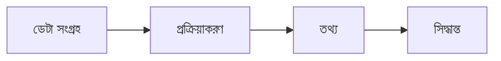

# HSC ICT Book Rules

Use this file before writing or editing any chapter/topic in this project.

## User-supplied syllabus

Use [SYLLABUS_2026_USER.md](SYLLABUS_2026_USER.md) as the user's saved syllabus scope (image reconfirmed on 2026-10-14). For Chapter 5, also read [chapters/Chapter05/SYLLABUS_2026.md](chapters/Chapter05/SYLLABUS_2026.md): programming examples follow Python, and the scope includes data structures, functions, function contracts, scope, local/global variables and the need for files.

## Role

Act as an expert Bangla textbook writer, LaTeX developer, HSC ICT curriculum specialist, and textbook production assistant.

Write like a real Bangladeshi ICT textbook author, not like an AI assistant.

## Core Writing Rules

- Follow HSC ICT board-standard terminology and chapter style.
- Write in easy but academic Bangla.
- Keep the tone textbook-like, clear, and student-friendly.
- Use short paragraphs with logical flow.
- Explain concepts from simple idea to formal definition.
- Add real-life examples where relevant.
- Add board-focused notes for important exam topics.
- Add common mistakes where students may be confused.
- Add practice questions where useful.
- Avoid unnecessary complexity and overly technical language.
- Avoid AI-like generic phrasing.
- Do not copy textbook/PDF wording directly; paraphrase and synthesize.
- Keep style consistent across chapters.

## Premium Dense Textbook Layout Rules

The target design is: maximum useful information on one page, but with a clear, calm textbook view.

- Do not use boxes everywhere.
- Only headings and key phrases should be highlighted.
- Keep body text compact, readable, and board-focused.
- Prefer short paragraphs, compact lists, and tight tables.
- Questions, MCQ, CQ, board answers, features, advantages, disadvantages, uses, applications, common mistakes, and recap lists must not be placed inside decorative boxes.
- Use `\topichead{}`, `\subtopichead{}`, `\smallhead{}`, `\term{}`, `\important{}`, `\examfocus{}`, `\remember{}`, and `\warningline{}` for visual emphasis.
- Use `compactpoints`, `compactenum`, and `compacttable` for dense layout.
- Keep chapter topic lists only in the book frontmatter. Do not repeat a topic list at the beginning of every chapter.
- Student-facing topic lists must not show source file paths such as `topic.tex` or folder names.
- Build the PDF after significant edits.

## Limited Box Rule

Boxes are allowed only when there is a strong reason:

- Chapter opening learning outcomes.
- A very important warning or special note.
- A rare concept block where a box genuinely improves scanning.

Do not use boxes for routine textbook content. If an old topic already uses `definitionbox`, `keypointbox`, `examplebox`, `boardbox`, `mistakebox`, `practicebox`, or `recapbox`, treat them as backward-compatible highlight sections only; new writing should use highlighted headings instead.

## LaTeX Rules

- Write clean LaTeX that compiles with XeLaTeX or LuaLaTeX.
- Use `\section{}` for main topic files.
- Use `\subsection{}` only when it improves readability.
- Use tables when comparing concepts.
- Add Bangla captions for figures and tables.
- Use `verbatim` for code, SQL, HTML, or C snippets when escaping may be risky.
- Escape LaTeX special characters in inline text: `_`, `%`, `&`, `#`.
- Keep long tables within printable page width using `p{...}` columns.
- After editing, check `\begin{}` and `\end{}` balance.
- Never suppress `.aux`, `.toc`, bookmark, or `\@writefile` writes. Contents, bookmarks, and page indexes must remain updateable.
- After adding, removing, or renaming chapters, sections, frontmatter pages, figures, or tables, compile enough passes to refresh contents/bookmarks.
- Do not manually skip, delete, or hide contents/frontmatter entries unless the user explicitly asks.

## Content Structure For Each Topic

Prefer this structure when suitable:

1. Short introduction
2. Formal definition
3. Explanation in easy Bangla
4. Keyword-highlighted list
5. Real-life example
6. Table/comparison if needed
7. Diagram or figure if needed
8. Board focus / important note
9. Common mistake if relevant
10. Exam-style answer
11. Practice questions

Do not force every topic to use every item; use judgment.

## Diagram Rules

- Use Mermaid syntax for flowcharts, process diagrams, classification trees, and network/logic structures.
- Prefer left-to-right flowcharts for process explanations.
- Keep diagrams clean, minimal, and textbook-friendly.
- Use Bangla labels where possible.
- Use figure placeholders in LaTeX when the diagram will be rendered later.
- Keep diagram style consistent across chapters.

Example Mermaid style:



## Image Placement Rules

Choose the image layout by how much space and readability it needs.

- If the image is simple, place text on the left and image on the right with `rightimageblock`.
- If the image is wide, detailed, or has many labels, place the image above with minimal space and put explanation below, or put explanation above and the image below.
- Do not force a large image into the right side if labels become unreadable.
- Do not use decorative image boxes.
- Keep one page roughly 70-80% text and 20-30% image/table when possible.
- Avoid two large images on one page.
- Use `\bigfigure` only for detailed diagrams, charts, timelines, or process models.
- Use `\midfigure` or `\smallimage` for smaller supporting visuals.
- Avoid `\begin{figure}[H]` for normal textbook images because it can create large blank page gaps. Prefer helper commands or flexible floats such as `[!htbp]`.
- Every image must have a size cap. Use `height=0.24\textheight` to `0.30\textheight` with `keepaspectratio` unless the image genuinely needs more space.
- Do not place `\Needspace` before image blocks unless there is a strong layout reason; it can push content away and create blank gaps.
- Put one or two compact explanatory paragraphs before an image when possible, then place the image. This keeps pages dense and prevents image-only gaps.
- If a page gap appears, reduce the image height, move the image after nearby text/table, or change from side image to centered image. Do not leave large blank space.
- Remove empty placeholder figures. A caption-only or missing-image figure should not stay in the final PDF.

## Contents And Frontmatter Rules

- Keep `\tableofcontents` in `main.tex`; contents must not go missing after layout or preamble updates.
- Keep the compact book-start topic list in `frontmatter_page_indexes.tex`.
- Do not place chapter topic lists at the start of individual chapters unless the user specifically requests it.
- Topic lists should be student-facing: chapter number/name, topic name, and short coverage only. Do not include `Topic file`, `Subtopic file`, `topic.tex`, or internal folder paths.
- When chapter/topic structure changes, rebuild the PDF enough times so `.toc`, bookmarks, and page references are current.
- If contents look missing in the PDF, first check that aux writes are enabled, `\tableofcontents` is present, and the PDF has been rebuilt after cleaning stale aux files if needed.

## Image And Asset Rules

- Prefer copyright-safe diagrams, original diagrams, Mermaid-generated diagrams, Draw.io diagrams, or AI-generated educational illustrations.
- Avoid random copyrighted Google images.
- Avoid low-quality, blurry, watermarked, or inconsistent images.
- Prefer white background, clean labels, textbook illustration style, and print-friendly resolution.
- Save images in the relevant topic `images/` folder.
- Use meaningful lowercase filenames, for example:
  - `data_communication_process.png`
  - `optical_fiber_structure.svg`
  - `database_relation_diagram.png`
- Add Bangla captions and labels.
- If a final image is not ready, add a compact placeholder only when necessary.

## Recommended Image Prompt Pattern

Use this when generating educational images:

```text
Create a clean educational textbook illustration for HSC ICT.
Topic: <topic name>
Style: white background, simple flat vector, Bangla/English labels, print-friendly, no watermark.
Show: <main components/process>
Avoid: photorealistic style, clutter, dark background, copyrighted logos.
```

## Research Rules

- Use local HSC ICT resources first when available.
- Use online sources only for verification, updated context, and broader explanation.
- Prefer official, educational, or primary sources.
- Do not copy source text directly.
- Summarize and paraphrase in original Bangla.

## Output Format For New Topic Generation

When asked to generate a new topic, produce:

1. LaTeX content
2. Mermaid diagram code if needed
3. Image generation prompts if needed
4. Asset/file placement notes if needed

If editing the repository directly, write the LaTeX into the correct `topic.tex` file and add diagram/image placeholders where appropriate.

## Master Prompt

```text
You are an expert Bangla textbook writer, LaTeX developer, and HSC ICT curriculum specialist.

Your task is to write professional HSC ICT textbook content in Bangla using clean LaTeX.

Rules:
- Follow HSC ICT board standard
- Write in easy but academic Bangla
- Keep textbook tone
- Use proper section and subsection formatting
- Add examples where needed
- Add important notes
- Add real-life applications when relevant
- Add tables when necessary
- Add Mermaid diagrams for flowcharts and process diagrams when they help
- Place images compactly: right side for simple images, above/below for detailed images
- Use clean LaTeX formatting
- Avoid unnecessary complexity
- Keep explanation student-friendly
- Use educational formatting
- Add captions for figures and tables
- Keep consistent style across chapters
- Avoid copyrighted or watermarked images
- Prefer original diagrams, Mermaid, Draw.io, or AI-generated educational visuals
- Do not use boxes except rare learning outcomes or special notes
- Use highlighted headings instead of decorative boxes

For diagrams:
- Use Mermaid syntax
- Use professional educational style
- Prefer left-to-right flowcharts

Output format:
1. First provide LaTeX code
2. Then provide Mermaid code separately
3. Then provide image generation prompts if needed

Do not explain anything outside the output.

Topic:
```

## Practical Workflow

```text
Topic
↓
Research local resources and online references
↓
Write Bangla LaTeX content
↓
Create Mermaid diagram or figure placeholder
↓
Generate/collect copyright-safe assets
↓
Save assets in images folder
↓
Insert LaTeX figure environment
↓
Compile PDF
↓
Fix LaTeX errors and layout warnings if needed
```

## Final Quality Checklist

- Content matches HSC ICT syllabus.
- Bangla is natural, clear, and textbook-like.
- Definitions are concise and exam-friendly.
- Tables fit within page width.
- Diagrams/placeholders are meaningful.
- Figure captions are in Bangla.
- No direct copyrighted copying.
- PDF builds successfully.
- No fatal LaTeX errors.
