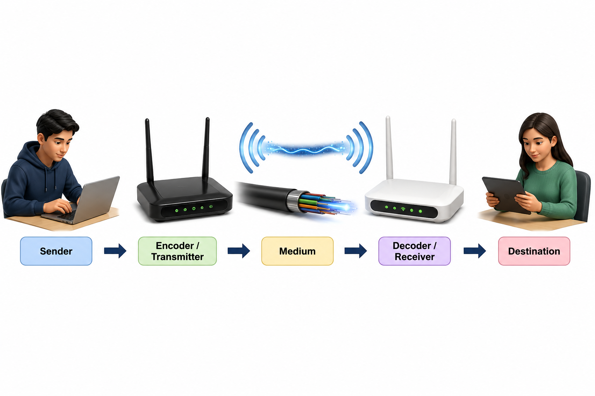

# Section 2.1 — বাংলা গদ্য সম্পাদনার প্রতিবেদন

লক্ষ্য: তথ্য কমানো নয়; একই তথ্য স্বাভাবিক, নির্ভুল ও পরীক্ষায় ব্যবহারযোগ্য বাংলায় লেখা। এই পর্বে শুধু Section 2.1-এর তিনটি উৎস ফাইল সম্পাদিত হয়েছে। প্রধান নির্দেশিকা: [CODEX_BANGLA_TEXT_QUALITY_INSTRUCTIONS.md](../../CODEX_BANGLA_TEXT_QUALITY_INSTRUCTIONS.md)। আপনার কথোপকথনে দেওয়া পূর্ণ নির্দেশনাই অগ্রাধিকার পেয়েছে।

## মূল লেখার সমস্যা

1. **LONG:** “Source ডেটা তৈরি করে; Transmitter সেটিকে প্রেরণযোগ্য সংকেতে রূপ দেয়; Channel সংকেত বহন করে; Receiver সংকেত থেকে ডেটা উদ্ধার করে; Destination সেই ডেটা ব্যবহার করে।” একই বাক্যে পাঁচটি ভূমিকা ছিল। প্রত্যেক ভূমিকা নিজের বাক্যে এসেছে।
2. **ENGLISH-HEAVY:** “নিজের Link-এর সংরক্ষিত হার থাকলেও অন্য পথ, Server বা Protocol-এর সীমায় File Download-এর প্রকৃত হার কমতে পারে।” পরিচিত বাংলা শব্দ থাকলেও চলতি গদ্যে অনেক ইংরেজি ছিল।
3. **TRANSLATED:** “বাস্তবে অ্যাপ্লিকেশনে সবটুকু পাওয়া বাধ্যতামূলক নয়।” প্রযুক্তিগত ফল বোঝাতে বাধ্যতামূলক শব্দটি স্বাভাবিক নয়; “পুরো হার পাওয়া নাও যেতে পারে” লেখা হয়েছে।
4. **VAGUE PRONOUN:** “বেশি Capacity থাকলে ... বিলম্বও ফলকে প্রভাবিত করে।” কোন ফল বোঝানো হয়েছে তা স্পষ্ট ছিল না; “বাস্তবে পাওয়া হার” বলা হয়েছে।
5. **ABSTRACT:** “Jitter: ধারাবাহিক প্যাকেটের বিলম্বের ওঠানামা।” যথার্থ অর্থ থাকলেও বাক্যটি সংজ্ঞার খণ্ডাংশ ছিল; পূর্ণ সংজ্ঞা ও ভিডিও ক্লাসের প্রয়োগ যুক্ত বাক্যে এসেছে।
6. **TRANSLATED:** “Latency ... কম Rate-এর বিপরীতে আলাদা সমস্যা।” বিপরীতে শব্দটি সম্পর্ক বোঝাচ্ছিল না; বিলম্ব ও কম ডেটা হারের সমস্যা পৃথক করে বলা হয়েছে।
7. **LONG / ENGLISH-HEAVY:** “Processing-এ ...; Transmission-এ ...।” কাজের নাম, ব্যাখ্যা ও উদাহরণ একসঙ্গে ছিল; বাংলা অর্থ আগে, তারপর প্রক্রিয়া ও উদাহরণ এসেছে।
8. **REPETITIVE:** যোগাযোগের সংজ্ঞায় “এক ব্যক্তি, যন্ত্র বা সিস্টেম থেকে অন্য ব্যক্তি, যন্ত্র বা সিস্টেমে” তালিকাটি দুবার ছিল; একই পরিসর রেখে “ব্যক্তি, যন্ত্র বা সিস্টেমের মধ্যে” লেখা হয়েছে।

## রেফারেন্সের লেখার কৌশল: ছবি দেখে বিশ্লেষণ

অক্ষরপত্র PDF 2–6: ধারণা থেকে অংশের কাজ, তারপর বিষয়ভিত্তিক উদাহরণ ও তুলনায় অগ্রসর হয়েছে। নামের সঙ্গে অর্থ জুড়ে দেওয়ার কৌশল নেওয়া হয়েছে; ঘন অনুচ্ছেদ ও আলাদা বইয়ের বাক্য নেওয়া হয়নি।

Systek PDF 2–6 এবং মাহবুবুর রহমান PDF 106–112: মূল বক্তব্য আগে, তারপর উপাদান/কাজ, ছোট ব্যাখ্যা ও হিসাবের উদাহরণ এসেছে। এই সাধারণ কৌশল অনুসরণ করে বাংলা বাক্য তৈরি হয়েছে; প্রশ্ন, সংখ্যা-পরিস্থিতি, সংজ্ঞা বা চিত্রবিন্যাস নকল করা হয়নি। নিজের পাণ্ডুলিপির উদাহরণ ও অঙ্কই রাখা হয়েছে।

অনলাইনে বহনক্ষমতা, থ্রুপুট, বিলম্ব ও জিটারের পৃথক অর্থ মিলিয়ে দেখা হয়েছে। [IBM-এর ব্যাখ্যা](https://www.ibm.com/think/topics/latency) এই পার্থক্য সমর্থন করে; লেখায় নতুন বিষয় বা অনলাইন উৎস-উল্লেখ ঢোকানো হয়নি। শিক্ষক বাতায়নের একটি পৃষ্ঠা অনুসন্ধানে পাওয়া গেলেও সরাসরি খোলা যায়নি (403); সেই পৃষ্ঠার অদেখা বিষয়কে সম্পাদনার প্রমাণ হিসেবে ব্যবহার করা হয়নি।

## সংশোধিত সম্পূর্ণ বাংলা লেখা

সম্পূর্ণ পাঠ: [CHAPTER02_SECTION21_REVISED_TEXT.md](CHAPTER02_SECTION21_REVISED_TEXT.md)। নিচে একই পাঠ দেওয়া হলো। মূল LaTeX-এর সব শিরোনাম রাখা হয়েছে। তিনটি নিজস্ব ভেক্টর চিত্র PDF-এ অপরিবর্তিত আছে; এই Markdown পাঠে তাদের বিষয়বস্তু ও ক্যাপশনও দেওয়া হয়েছে।

# 2.1 কমিউনিকেশন সিস্টেম ও ব্যান্ডউইথ

কলেজে ভর্তির ফরম পাঠানোর পর শিক্ষার্থী একটি নিশ্চিতকরণ বার্তা আশা করে। বার্তাটি না এলে আবেদন জমা হয়েছে কি না, তা বোঝা কঠিন হয়। সফল যোগাযোগের জন্য তাই শুধু ইন্টারনেট সংযোগ থাকলেই চলে না। তথ্য সঠিক গন্তব্যে, সঠিকভাবে এবং প্রয়োজনীয় সময়ে পৌঁছাতে হয়। যোগাযোগের উপাদান ও সংযোগের বহনক্ষমতা জানা থাকলে এমন সমস্যার কারণ খুঁজে পাওয়া সহজ হয়।

## 2.1.1 যোগাযোগ ও ডেটা কমিউনিকেশন

**যোগাযোগ (Communication)**

ব্যক্তি, যন্ত্র বা সিস্টেমের মধ্যে বার্তা বা তথ্য আদান-প্রদানের প্রক্রিয়াকে যোগাযোগ বলে।

**যোগাযোগব্যবস্থা (Communication System)**

বার্তা পাঠানো ও গ্রহণের জন্য প্রেরক, প্রাপক, মাধ্যম, প্রয়োজনীয় যন্ত্র এবং যোগাযোগের নিয়ম নিয়ে যে সম্পূর্ণ ব্যবস্থা গড়ে ওঠে, তাকে যোগাযোগব্যবস্থা বলে।

**ডেটা কমিউনিকেশন (Data Communication)**

যোগাযোগমাধ্যম ও নির্দিষ্ট নিয়ম মেনে এক যন্ত্র থেকে অন্য যন্ত্রে ডেটা আদান-প্রদানের প্রক্রিয়াকে ডেটা কমিউনিকেশন বলে। আদান-প্রদান করা ডেটা ডিজিটাল বা অ্যানালগ রূপে প্রকাশিত হতে পারে।

ফোনে কথা বলা, ই-মেইল আদান-প্রদান, ভিডিও ক্লাস, অনলাইন ব্যাংকিং ও ফাইল পাঠানো যোগাযোগব্যবস্থার পরিচিত ব্যবহার। ভর্তির আবেদন গ্রহণের পর কলেজের সার্ভার শিক্ষার্থীকে ফিরতি বার্তা পাঠায়। শিক্ষার্থী দূরে থেকেই আবেদন জমা দিতে পারে এবং জমা হওয়ার খবর জানতে পারে।
**স্থানীয় যোগাযোগ (Local Communication):** কাছাকাছি থাকা ব্যক্তিরা সরাসরি কথা, লেখা বা ইশারায় যোগাযোগ করলে তাকে স্থানীয় যোগাযোগ বলে। যেমন, শ্রেণিকক্ষে শিক্ষক বোর্ডের একটি চিত্র ইশারায় বোঝান।

**দূরবর্তী যোগাযোগ (Remote Communication):** দূরে থাকা ব্যক্তি বা যন্ত্রের সঙ্গে মাধ্যম ও প্রয়োজনীয় প্রযুক্তির সাহায্যে যোগাযোগকে দূরবর্তী যোগাযোগ বলে। অন্য শহরের শিক্ষকের সঙ্গে ফোনে কথা বলা বা অনলাইন ক্লাস করা এর উদাহরণ।
বৈদ্যুতিক বা বিদ্যুৎচৌম্বক সংকেতের সাহায্যে দূরবর্তী স্থানে যোগাযোগকে টেলিকমিউনিকেশন (Telecommunication) বলে। স্থানীয় ও দূরবর্তী যোগাযোগ দিয়ে যোগাযোগের পরিস্থিতি বোঝানো হয়। অন্যদিকে, LAN/WAN দিয়ে নেটওয়ার্কের বিস্তৃতি বোঝানো হয়।

## 2.1.2 পাঁচটি উপাদান ও তাদের কাজ

**কাজের দুটি দিক:** ডেটা কমিউনিকেশনে ডেটা প্রক্রিয়াকরণ (Data Processing) এবং ডেটা পাঠানো (Data Transmission) পৃথক কাজ। প্রক্রিয়াকরণের সময় ডেটা প্রস্তুত ও বিন্যস্ত করা হয়, প্রয়োজনে উপযোগী রূপে বদলানো হয়। এরপর যোগাযোগমাধ্যম দিয়ে ডেটা অন্য প্রান্তে পাঠানো হয়।

যেমন, ভর্তি ফরমের ঘরগুলো যাচাই করে পাঠানোর উপযোগী করা প্রক্রিয়াকরণের কাজ; ফরমটি সার্ভারে পাঠানো হলো ডেটা প্রেরণের কাজ। নিচের পাঁচটি উপাদান যোগাযোগব্যবস্থার অংশ বোঝায়; কাজের এই দুই দিকের সঙ্গে উপাদানের সংখ্যা এক করে দেখা যাবে না।

| **উপাদান** | **কাজ** | **ভর্তি ফরমের উদাহরণ** |
| --- | --- | --- |
| প্রেরক (Sender) | ডেটা পাঠায়। | শিক্ষার্থীর ফোন। |
| বার্তা (Message) | যে ডেটা পাঠানো হয়। | নাম, রোল, ছবি ও আবেদন। |
| মাধ্যম (Medium) | সংকেত বহন করার পথ। | Wi-Fi-এর রেডিও তরঙ্গ ও পথে থাকা কেবল। |
| প্রাপক (Receiver) | ডেটা গ্রহণ করে। | কলেজের সার্ভার। |
| প্রোটোকল (Protocol) | ডেটার বিন্যাস, সময় ও আদান-প্রদানের নিয়ম নির্ধারণ করে। | দুই পক্ষ যে নিয়মে আবেদন পাঠায় ও বোঝে। |

**প্রোটোকলের প্রয়োজন:** অর্থপূর্ণ যোগাযোগের জন্য দুই পক্ষকে ডেটার বিন্যাস ও আদান-প্রদানের একই নিয়ম অনুসরণ করতে হয়। প্রোটোকল এই নিয়ম নির্ধারণ করে। ফিরতি বার্তা পাঠানোর সময় সার্ভার প্রেরক হয় এবং শিক্ষার্থীর ফোন প্রাপক হয়।

বার্তা মাধ্যমে যায়; দুই প্রান্ত একই নিয়ম অনুসরণ করে

ইন্টারনেট অনেক নেটওয়ার্ক নিয়ে গঠিত; এটি কোনো নির্দিষ্ট ভৌত কেবল নয়। প্রোটোকলও যন্ত্র বা যোগাযোগমাধ্যম নয়, বরং আদান-প্রদানের নিয়ম। ওয়েবে আদান-প্রদানে HTTP, ফাইল স্থানান্তরে FTP এবং ই-মেইল পাঠাতে SMTP ব্যবহৃত হয়।

**প্রোটোকলের তিনটি দিক:** বার্তার বিন্যাসকে Syntax বলা হয়। Semantics দিয়ে বার্তার প্রতিটি অংশের অর্থ ও সে অনুযায়ী করণীয় বোঝানো হয়। Timing নির্ধারণ করে কখন, কী ক্রমে এবং কী হারে ডেটা আদান-প্রদান হবে।

ভর্তি ফরমে রোল কোন ঘরে থাকবে, তা বিন্যাসের উদাহরণ। সফল বা ব্যর্থ হওয়ার বার্তার অর্থ বোঝা তাৎপর্যের উদাহরণ। অনুরোধ ও ফিরতি বার্তা কখন পাঠানো হবে, তা সময়ের সমন্বয়ের উদাহরণ। একই কেবল ব্যবহার করলেও দুই পক্ষের নিয়ম না মিললে অর্থপূর্ণ যোগাযোগ হয় না।

**প্রথম ব্যবহারের পূর্ণরূপ**

TCP = Transmission Control Protocol; IP = Internet Protocol; HTTP = Hypertext Transfer Protocol; FTP = File Transfer Protocol; SMTP = Simple Mail Transfer Protocol। TCP/IP একাধিক যোগাযোগ-প্রোটোকল নিয়ে গঠিত একটি সমষ্টি, যাকে প্রোটোকল স্যুট (Protocol Suite) বলে।

## 2.1.3 উৎস থেকে গন্তব্য: সংকেতের পথ

উৎস (Source) → প্রেরণযন্ত্র (Transmitter) → চ্যানেল (Channel) → গ্রহণযন্ত্র (Receiver) → গন্তব্য (Destination)।

*উৎসের ডেটা প্রেরণযোগ্য সংকেত হয়ে মাধ্যমে যায় এবং গন্তব্যে ব্যবহারযোগ্য হয়*

**উৎস (Source)** ডেটা তৈরি করে। **প্রেরণযন্ত্র (Transmitter)** ডেটাকে মাধ্যমে পাঠানোর উপযোগী সংকেতে রূপ দেয়। **চ্যানেল (Channel)** সেই সংকেত বহন করে। **গ্রহণযন্ত্র (Receiver)** সংকেত থেকে ডেটা উদ্ধার করে এবং **গন্তব্য (Destination)** সেই ডেটা ব্যবহার করে।

উদাহরণ হিসেবে মাইক্রোফোন থেকে কণ্ঠস্বরের ডেটা পাওয়া যায়; অপর প্রান্তের স্পিকার তা শোনার উপযোগী করে প্রকাশ করে। প্রচলিত মডেম প্রেরক প্রান্তে মডুলেশন (Modulation) এবং গ্রাহক প্রান্তে ডিমডুলেশন (Demodulation) করতে পারে। মডেমের কাজ নেটওয়ার্ক ডিভাইসের অংশে বিস্তারিত আলোচনা করা হয়েছে।

**দুটি মডেলের ভিত্তি আলাদা**

পাঁচ উপাদানের মডেলে **বার্তা ও প্রোটোকল** অন্তর্ভুক্ত থাকে। সংকেত প্রবাহের মডেলে **উৎস, রূপান্তর ও গন্তব্যের ভূমিকা** দেখানো হয়। তাই প্রেরক ও প্রেরণযন্ত্র, কিংবা গ্রহণযন্ত্র ও গন্তব্যের কাজ সব ক্ষেত্রে এক নয়। তবে একই যন্ত্র একাধিক ভূমিকা পালন করতে পারে।

## 2.1.4 ডেটা বহন করে সিগন্যাল

ডেটা ও তথ্যের পার্থক্য প্রথম অধ্যায়ে আলোচনা করা হয়েছে। পরীক্ষার বিষয়ভিত্তিক নম্বরগুলো ডেটা; নম্বরগুলো ব্যবহার করে তৈরি ফলাফল অর্থপূর্ণ তথ্য। ফলাফল ফোনে পাঠানোর সময় বৈদ্যুতিক পালস, আলো বা রেডিও তরঙ্গ সেই ডেটা বহন করে।

**সিগন্যাল (Signal)**

ডেটা বহনকারী বৈদ্যুতিক, আলোকীয় বা বিদ্যুৎচৌম্বক পরিবর্তনকে সংকেত বা সিগন্যাল বলে। বার্তা হলো পাঠানো বিষয়বস্তু; সংকেত হলো সেই বিষয়বস্তু বহনের রূপ।

## 2.1.5 অ্যানালগ ও ডিজিটাল সিগন্যাল

**Analog Signal**

যে সংকেতের মান নির্দিষ্ট সীমার মধ্যে ধারাবাহিকভাবে পরিবর্তিত হতে পারে, তাকে অ্যানালগ সংকেত বলে।

মাইক্রোফোনে কণ্ঠস্বরের বৈদ্যুতিক প্রকাশ অ্যানালগ সংকেতের উদাহরণ। এই সংকেতে মধ্যবর্তী মানও থাকতে পারে।

**Digital Signal**

যে সংকেত নির্দিষ্ট বিচ্ছিন্ন স্তরের সাহায্যে ডেটা প্রকাশ করে, তাকে ডিজিটাল সংকেত বলে। প্রচলিত বাইনারি ব্যবস্থায় দুটি স্তর দিয়ে 0 ও 1 প্রকাশ করা হয়।

কম্পিউটারের বাইনারি ডেটা সংরক্ষণ ও আদান-প্রদানে ডিজিটাল সংকেত উপযোগী।

| **বিষয়** | **Analog Signal** | **Digital Signal** |
| --- | --- | --- |
| মান | ধারাবাহিক; মধ্যবর্তী মান থাকতে পারে | নির্দিষ্ট বিচ্ছিন্ন স্তর |
| আদর্শ চিত্র | মসৃণ রেখা বা তরঙ্গ | স্তর বদলানো পালস |
| উদ্ধার | সংকেতের মানের পরিবর্তন অনুসরণ | স্তর শনাক্ত করে বিট পুনর্গঠন; ত্রুটি পরীক্ষাও সম্ভব |
| উদাহরণ | মাইক্রোফোনের অ্যানালগ আউটপুট | বাইনারি ডেটার বৈদ্যুতিক পালস |

চিত্রে অ্যানালগ সংকেতের ধারাবাহিক মান এবং ডিজিটাল সংকেতের নির্দিষ্ট স্তর দেখানো হয়েছে; বাইনারি উদাহরণে স্তর দুটি 0 ও 1। সময় (Time) ও স্তর (Level) অক্ষ বরাবর পরিবর্তন দেখানো হয়েছে।

*একদিকে ধারাবাহিক মান; অন্যদিকে নির্দিষ্ট স্তর দিয়ে বিট প্রকাশের আদর্শ চিত্র*

ডিজিটাল সংকেতের নির্দিষ্ট স্তর শনাক্ত করে গ্রহণকারী বিট উদ্ধার ও পুনর্গঠন করতে পারে। তবে নয়েজ বেশি হলে ভুল বিট পড়তে পারে। তাই ডিজিটাল যোগাযোগও সবসময় ত্রুটিমুক্ত নয়। রেডিও তরঙ্গ দিয়ে ডিজিটাল ডেটা বহন করা যায়। মাধ্যমের নাম থেকে তাই ডেটা অ্যানালগ না ডিজিটাল, তা নির্ধারণ করা যায় না।

## 2.1.6 সফল যোগাযোগের চারটি মৌলিক গুণ

**সঠিক গন্তব্যে পৌঁছানো (Delivery):** ডেটা নির্ধারিত প্রাপকের কাছে পৌঁছাতে হবে। ভর্তি ফরম অন্য কলেজে পৌঁছালে আবেদনের উদ্দেশ্য পূরণ হবে না।

**নির্ভুলতা (Accuracy):** ডেটা বিকৃত না হয়ে প্রাপকের কাছে পৌঁছাতে হবে। সঠিক প্রাপকের কাছে গেলেও টাকার অঙ্ক বদলে গেলে লেনদেন ভুল হবে।

**সময়মতো পৌঁছানো (Timeliness):** ডেটা প্রয়োজনীয় সময়ের মধ্যে পৌঁছাতে হবে। পরীক্ষার নির্ধারিত সময় শেষ হওয়ার পর উত্তর পৌঁছালে তা কাজে আসে না।

**বিলম্বের ওঠানামা (Jitter):** ধারাবাহিক প্যাকেট পৌঁছাতে যে বিলম্ব হয়, তার ওঠানামাকে জিটার বলে। জিটার বেশি হলে ভিডিও ক্লাসের শব্দ ভেঙে আসতে পারে। তাই কম জিটার কাম্য।
সফল যোগাযোগে নিরাপত্তা ও নির্ভরযোগ্যতাও প্রয়োজন। অনুমতিহীন ব্যবহার ঠেকাতে হয় এবং প্রয়োজনের সময়ে সেবা সচল রাখতে হয়। তবে যোগাযোগের প্রচলিত চারটি মৌলিক গুণ হলো সঠিক গন্তব্যে পৌঁছানো, নির্ভুলতা, সময়মতো পৌঁছানো এবং কম জিটার। মনে রাখবে, বিলম্ব বেশি হওয়া ও বিলম্বের ওঠানামা আলাদা সমস্যা।

## 2.1.7 সংকেত দুর্বল বা বিকৃত হওয়ার কারণ

| **সমস্যা** | **কী হয়** | **করণীয়ের উদাহরণ** |
| --- | --- | --- |
| সংকেতের ক্ষয় (Attenuation) | দূরত্ব বাড়লে সংকেতের শক্তি কমে। | উপযুক্ত মাধ্যম বা সংকেত পুনর্গঠনের ব্যবস্থা। |
| সংকেতের বিকৃতি (Distortion) | সংকেতের আকৃতি বদলায়; বিভিন্ন অংশের বিলম্ব ভিন্ন হতে পারে। | উপযুক্ত মাধ্যম, সংকেতের উপযোগী বিন্যাস বা এনকোডিং (Encoding) এবং গ্রহণব্যবস্থা। |
| নয়েজ (Noise) | অনাকাঙ্ক্ষিত সংকেত মূল সংকেতের সঙ্গে মেশে। | বিঘ্নের উৎস থেকে দূরে রাখা, সুরক্ষামূলক আবরণ বা শিল্ডিং (Shielding) এবং ত্রুটি শনাক্তকরণ। |

**EMI (Electromagnetic Interference)** হলো বাইরের বিদ্যুৎচৌম্বক ক্ষেত্রের কারণে সংকেতে সৃষ্ট বিঘ্ন। মোটরের পাশে থাকা তামার কেবলে এ ধরনের সমস্যা হতে পারে। অপটিক্যাল ফাইবারের আলোকপথ EMI-তে প্রভাবিত হয় না। তবে অতিরিক্ত বাঁক, কাটা পড়া বা সংযোগস্থলের ক্ষতিতে ফাইবারের সংকেতে সমস্যা হতে পারে। কেবলের গঠন ও রিপিটারের কাজ সংশ্লিষ্ট অংশে আলোচনা করা হয়েছে।

## 2.1.8 ব্যান্ডউইথ: ক্ষমতা ও ফ্রিকোয়েন্সির প্রস্থ

**Bandwidth**

ডিজিটাল নেটওয়ার্কে একটি সংযোগের সর্বোচ্চ ডেটা বহনের হারকে ব্যান্ডউইথ বা বহনক্ষমতা (Capacity) বলে। এর একক বিট প্রতি সেকেন্ড বা bits per second (bps)। ফ্রিকোয়েন্সির ক্ষেত্রে ব্যান্ডউইথ হলো সর্বোচ্চ ও সর্বনিম্ন ফ্রিকোয়েন্সির পার্থক্য; এর একক হার্টজ (Hertz, Hz)।

**ডেটা বহনের হার:** 10 Mbps সংযোগের নামমাত্র বহনক্ষমতা প্রতি সেকেন্ডে 10 মিলিয়ন বিট। বাস্তবে ব্যবহৃত অ্যাপ্লিকেশনে এই পুরো হার পাওয়া নাও যেতে পারে।

**ফ্রিকোয়েন্সির প্রস্থ:** সর্বনিম্ন ফ্রিকোয়েন্সি 1000 Hz এবং সর্বোচ্চ ফ্রিকোয়েন্সি 4000 Hz হলে ব্যান্ডউইথ 4000-1000=3000 Hz। Hz ও bps ভিন্ন পরিমাণের একক; সরাসরি সমান ধরে নেওয়া যায় না।
বহনক্ষমতা বেশি হলে একই সময়ে বেশি ডেটা পাঠানোর সুযোগ থাকে। তবে বাস্তবে পাওয়া হার মাধ্যম ও যন্ত্রের সামর্থ্য, অন্য ব্যবহারকারীর চাপ, সার্ভারের সাড়া এবং যোগাযোগের বিলম্বের ওপরও নির্ভর করে।

## 2.1.9 bit, Byte ও হারের একক

বিট (bit)-এর পূর্ণরূপ **Binary Digit**; এর মান 0 বা 1। 1 Byte=8 bit। এককের চিহ্নে ছোট হাতের b দিয়ে বিট এবং বড় হাতের B দিয়ে বাইট বোঝানো হয়। তাই 8 Mbps ও 8 Megabyte/s (MB/s) একই হার নয়।

| **চিহ্ন** | **পূর্ণরূপ** | **মান** |
| --- | --- | --- |
| bps | bits per second | বিট/সেকেন্ড |
| kbps (Kbps) | kilobits per second | 10³ bps |
| Mbps | megabits per second | 10⁶ bps |
| Gbps | gigabits per second | 10⁹ bps |
| Tbps / Pbps | terabits / petabits per second | 10¹² / 10¹⁵ bps |

নেটওয়ার্কে ডেটা বহনের হার প্রকাশে দশমিক একক ব্যবহৃত হয়। দশমিক হিসাবে MB হলো 10⁶ Byte; অন্যদিকে, মেবিবাইট বা Mebibyte (MiB) হলো 2²⁰ Byte। প্রশ্নে MB-কে 1024² Byte ধরা হলে সেই প্রদত্ত শর্ত অনুযায়ী হিসাব করতে হবে। দশমিক হারের সঙ্গে বাইনারি ভিত্তিতে প্রকাশিত ফাইলের আকার ব্যবহার করার আগে এককের ভিত্তি মিলিয়ে নিতে হবে।

## 2.1.10 প্রচলিত ব্যান্ডউইথ শ্রেণি

নিচের ছকে পরীক্ষায় প্রচলিত ব্যান্ডউইথের শ্রেণিবিন্যাস দেখানো হয়েছে। আধুনিক প্রযুক্তিতে ব্রডব্যান্ডের সংজ্ঞা ও গতি মানদণ্ডভেদে ভিন্ন হতে পারে।

| **শ্রেণি** | **প্রচলিত হার** | **ব্যবহার ও পরিচয়** |
| --- | --- | --- |
| Narrowband | 45--300 bps | টেলিগ্রাফ ও ধীর বার্তা আদান-প্রদান। |
| Voiceband | 1200--9600 bps | টেলিফোন-চ্যানেলে প্রচলিত ডেটা যোগাযোগ। |
| Broadband | 1 Mbps বা বেশি | বেশি ডেটা বহন: কেবল, ফাইবার ও উপযুক্ত বেতার সংযোগ। |

bps থেকে kbps-এ রূপান্তর করতে 1000 দিয়ে ভাগ করতে হয়। যেমন, 9600 bps =9.6 kbps এবং 300 bps =0.3 kbps। মনে রাখবে, এই ঐতিহাসিক শ্রেণিবিন্যাসে দেওয়া 9600 bps টেলিফোনের সব প্রযুক্তির সর্বোচ্চ গতিসীমা নয়।
**ওয়াইডব্যান্ড (Wideband)** দিয়ে সাধারণত বিস্তৃত ফ্রিকোয়েন্সি-পরিসরের সংকেত বা চ্যানেল বোঝানো হয়। ওয়াইডব্যান্ডকে ওপরের তিনটি শ্রেণির সঙ্গে যোগ করে ডেটা হারের চতুর্থ সীমা ধরা যাবে না। Hz-এ ব্যান্ডউইথ নির্ণয় করতে প্রশ্নে দেওয়া সর্বোচ্চ ও সর্বনিম্ন ফ্রিকোয়েন্সির পার্থক্য নিতে হবে।

## 2.1.11 Capacity, Throughput, Latency ও Bottleneck

| **ধারণা** | **অর্থ ও উদাহরণ** |
| --- | --- |
| বহনক্ষমতা (Capacity) | সংযোগের সর্বোচ্চ ডেটা বহনের হার; যেমন নামমাত্র 10 Mbps। |
| থ্রুপুট (Throughput) | নির্দিষ্ট সময়ে সফলভাবে পৌঁছানো ডেটার হার; বাস্তবে 6 Mbps হতে পারে। |
| বিলম্ব (Latency) | প্রেরক থেকে প্রাপকের কাছে ডেটা পৌঁছাতে যে সময় লাগে; কম ডেটা হারের সমস্যা থেকে এটি আলাদা। |
| বটলনেক (Bottleneck) | পথে সবচেয়ে কম বহনক্ষমতার অংশ, যা পুরো পথের ডেটা হার সীমিত করে। |

ডেটার সঙ্গে পাঠানো নিয়ন্ত্রণতথ্য বা হেডার (Header), অন্য ব্যবহারকারীর ডেটা চলাচল, পুনঃপ্রেরণ এবং সার্ভারের সীমাবদ্ধতা অ্যাপ্লিকেশনে পাওয়া হার কমায়। বহনক্ষমতা ও বিলম্বের পার্থক্য একটি রাস্তার উদাহরণে বোঝা যায়। চওড়া রাস্তা দিয়ে বেশি গাড়ি চলতে পারে, কিন্তু যানজট হলে গন্তব্যে পৌঁছাতে দেরি হয়।
**ভাগ করা সংযোগ (Shared Connection):** একাধিক গ্রাহক সংযোগের একই অংশের বহনক্ষমতা ভাগ করে ব্যবহার করেন। ২০ Mbps-এর একটি সংযোগ চারজন সমানভাবে ব্যবহার করলে সরল হিসাবে জনপ্রতি ৫ Mbps পাওয়া যায়। বাস্তবে চাহিদা ও নিয়ন্ত্রণব্যবস্থা অনুযায়ী এই ভাগ পরিবর্তিত হতে পারে।

**সংরক্ষিত সংযোগ (Dedicated Connection):** চুক্তিতে নির্ধারিত বহনক্ষমতা গ্রাহকের জন্য সংরক্ষিত থাকে। তবে নিজের সংযোগে এই হার সংরক্ষিত থাকলেও পুরো পথের অন্য অংশ, সার্ভার বা প্রোটোকলের সীমাবদ্ধতায় ফাইল ডাউনলোডের প্রকৃত হার কমতে পারে।

## 2.1.12 সেবাভেদে প্রচলিত Data Rate-এর উদাহরণ

নিচের ছকে বিভিন্ন সেবার প্রচলিত ডেটা হারের উদাহরণ দেওয়া হয়েছে। নির্দিষ্ট মানভিত্তিক প্রশ্নে সেবার নামের সঙ্গে হারটি মিলিয়ে দেখতে হবে। বাস্তবে প্রয়োজনীয় হার সফটওয়্যার, সেবার মান ও ব্যবহারের ধরন অনুযায়ী পরিবর্তিত হয়। তাই ছকের মানগুলো নিশ্চিত সর্বনিম্ন চাহিদা নয়।

| **উদাহরণ হার** | **পরিষেবা** |
| --- | --- |
| 0.5 Mbps | VoIP ফোন কল, ই-মেইল ও গান স্ট্রিমিং। |
| 0.5--1 Mbps | ওয়েব ব্রাউজিং। |
| 0.7 Mbps | ভিডিও স্ট্রিমিং। |
| 1 Mbps | সাধারণ ভিডিও কনফারেন্সিং ও ইন্টারনেট গেম কনসোল। |
| 1.5 Mbps | চলচ্চিত্র স্ট্রিমিং। |
| 4 Mbps | HD চলচ্চিত্র স্ট্রিমিং, HD ভিডিও কনফারেন্সিং ও অনলাইন HD মাল্টিপ্লেয়ার গেম। |

**VoIP** = Voice over Internet Protocol; **HD** = High Definition। **0.7 Mbps ভিডিও স্ট্রিমিংয়ের উদাহরণ হার**; এই ছকে VoIP-এর জন্য অন্য মান দেওয়া আছে। বাস্তবে অডিও–ভিডিও সংকোচন ও উদ্ধারের ব্যবস্থা বা কোডেক (Codec), ছবির বিস্তারিত প্রকাশের মাত্রা বা রেজল্যুশন (Resolution), ডেটা সংকোচন (Compression) এবং একসঙ্গে ব্যবহারকারীর সংখ্যা অনুযায়ী প্রয়োজনীয় হার বদলায়। অনলাইন ক্লাসের সংযোগ বেছে নেওয়ার সময় তাই শুধু এই ছক যথেষ্ট নয়। আপলোডের হার ও যোগাযোগের বিলম্বও দেখতে হয়।

## 2.1.13 Baud ও Bit Rate-এর পার্থক্য

**Baud (Bd)**

প্রতি সেকেন্ডে পাঠানো সংকেত-প্রতীকের হার প্রকাশের একক বড (Baud)। একটি সংকেত-প্রতীক বা সিম্বল (Symbol) এক বা একাধিক বিট প্রকাশ করতে পারে। তাই বড ও bps-এর মান সবসময় সমান হয় না।

প্রতিটি সিম্বলে সমান সংখ্যক বিট প্রকাশিত হলে,

Bit Rate=Symbol Rate×bits per symbol.

2400 Baud-এ প্রতিটি সিম্বল দুই বিট প্রকাশ করলে ডেটার হার 2400×2=4800 bps। প্রতিটি সিম্বল এক বিট প্রকাশ করলে বড ও bps-এর সংখ্যাগত মান সমান হয়। মনে রাখবে, এই হিসাব একটি ক্যারেক্টার বা চরিত্রের ডেটা, স্টার্ট ও স্টপ বিট গণনার বিকল্প নয়। ফ্রেমিং ও কার্যকর ডেটার অনুপাত পরের অংশে আলোচনা করা হয়েছে।

## 2.1.14 হিসাব: আগে একক, তারপর সূত্র

প্রেরিত ডেটা D bit এবং সময় t s হলে ডেটা পাঠানোর পর্যবেক্ষিত গড় হার R=D/t bps। নির্দিষ্ট হারে ডেটা পাঠানোর আদর্শ **সময় (Transmission Time)** হলো t=D/R। অন্যান্য বিলম্ব এবং নিয়ন্ত্রণতথ্য পাঠানোর মতো বাড়তি কাজ (Overhead) থাকলে মোট সময় বাড়বে।
**উদাহরণ ১: গড় হার**

5 সেকেন্ডে 9000 bit ডেটা পাঠানো হলে গড় হার R=9000/5=1800 bps। আবার 5 সেকেন্ডে 50,000 bit পাঠানোর হিসাবে হার হবে R=10,000 bps =10 kbps।

**উদাহরণ ২: Byte থেকে bit**

500 Byte ডেটা দুই সেকেন্ডে পাঠানো হলে D=500×8=4000 bit। সুতরাং গড় হার R=4000/2=2000 bps। একই হার বাইটে প্রকাশ করলে 250 Byte/s হয়; 250 bps হয় না।

**গড় Rate থেকে Capacity দাবি নয়**

বাস্তবে পাওয়া D/t একটি পর্যবেক্ষিত গড় হার; তা থেকে সংযোগের সর্বোচ্চ বহনক্ষমতা জানা যায় না। প্রশ্নে সংযোগ সর্বোচ্চ হারে চলেছে বলা থাকলে সেই শর্তে বহনক্ষমতা নির্ণয় করা যায়। হিসাবের আগে মিনিটকে সেকেন্ডে এবং বাইটকে বিটে রূপান্তর করতে হবে। ডেটা হারের এককগুলোর ভিত্তিও মিলিয়ে নিতে হবে।

## 2.1.15 বাস্তব সমস্যা: স্থানীয় Link দ্রুত, Upload ধীর

একজন শিক্ষার্থীকে কলেজে 12 MB-এর একটি ভিডিও পাঠাতে হবে। স্থানীয় সংযোগের ক্ষমতা 100 Mbps, ইন্টারনেটে আপলোডের সংযোগ 3 Mbps এবং অপর প্রান্তের গ্রহণক্ষমতা 20 Mbps। পাঠাতে কত সময় লাগবে, তা জানতে শুধু স্থানীয় সংযোগের হার দেখলে চলবে না।

কম্পিউটার → স্থানীয় সংযোগ 100 Mbps → আপলোড সংযোগ 3 Mbps → প্রাপক 20 Mbps।

*এই পথে 3 Mbps অংশটি ডেটা হার সীমিত করে; স্থানীয় 100 Mbps পুরো পথের হার নয়*

**সমাধান:** এই পথে বটলনেক হলো 3 Mbps আপলোড সংযোগ। দশমিক MB ধরে D=12×8=96 Mbit। আদর্শ প্রেরণসময় 96/3=32 সেকেন্ড। বাস্তবে থ্রুপুট কম হলে আরও সময় লাগবে।

**ব্যবহার:** বড় অ্যাসাইনমেন্ট পাঠানো বা ক্লাউডে ব্যাকআপ রাখার সময় পরিকল্পনা করতে আপলোডের হার জানতে হয়। একই সময়ে বড় ফাইল আপলোড করলে ভিডিও ক্লাসের ডেটা সময়মতো পৌঁছাতে বাধা হতে পারে।
এমন সমস্যায় অপ্রয়োজনীয় আপলোড ও ডাউনলোড বন্ধ করে সংযোগ পরীক্ষা করা যায়। Wi-Fi সংকেত ও তারের সংযোগও দেখতে হয়। প্রয়োজনে ভিডিওর রেজল্যুশন কমানো যেতে পারে। শুধু 4G/5G পরিচয় বা বড় Mbps মান দেখে সরাসরি অনলাইন ক্লাসের ভালো মান নিশ্চিত করা যায় না।

**সম্পূরক: যোগাযোগের বিকাশ**

**টেলিফোন: Bell ও ১৮৭৬**

Alexander Graham Bell ৭ মার্চ ১৮৭৬ সালে টেলিফোন-সংক্রান্ত মার্কিন পেটেন্ট পান। ১০ মার্চ তাঁর পরীক্ষায় বোধগম্য কথা অপর প্রান্তে পৌঁছায়। টেলিফোনের ইতিহাসে তাই Bell-এর নামের সঙ্গে ১৮৭৬ সাল গুরুত্বপূর্ণ। এই সাল পরবর্তী সেলুলার হ্যান্ডসেট আবিষ্কারের সাল নয়।

**তথ্যতত্ত্ব: Shannon ও ১৯৪৮**

Claude Shannon-এর ১৯৪৮ সালের গবেষণা যোগাযোগে তথ্যের পরিমাণ, নয়েজ এবং চ্যানেলের সীমা বিশ্লেষণের ভিত্তি গড়ে দেয়। তাঁকে তথ্যতত্ত্ব বা Information Theory-এর জনক বলা হয়। টেলিফোনের যন্ত্র, তথ্যতত্ত্ব এবং ইন্টারনেটের প্রোটোকলের বিকাশ পৃথক ঘটনা।
রেডিওর বিকাশের ইতিহাস বেতার যোগাযোগের অংশে এবং Ethernet/TCP-IP-এর ইতিহাস কম্পিউটার নেটওয়ার্কের অংশে রয়েছে।

## Before → After samples

### 1. TRANSLATED

**Before:** বার্তা পাঠানো ও গ্রহণের জন্য প্রেরক, প্রাপক, মাধ্যম, যোগাযোগের নিয়ম এবং প্রয়োজনীয় যন্ত্র নিয়ে গঠিত সম্পূর্ণ ব্যবস্থাকে যোগাযোগব্যবস্থা বলে।

**After:** বার্তা পাঠানো ও গ্রহণের জন্য প্রেরক, প্রাপক, মাধ্যম, প্রয়োজনীয় যন্ত্র এবং যোগাযোগের নিয়ম নিয়ে যে সম্পূর্ণ ব্যবস্থা গড়ে ওঠে, তাকে যোগাযোগব্যবস্থা বলে।

**কারণ:** গঠিত সম্পূর্ণ ব্যবস্থাকে-এর বদলে স্বাভাবিক সংজ্ঞার বাক্য ব্যবহার করা হয়েছে।

### 2. LONG; ENGLISH-HEAVY

**Before:** **কাজের দুটি দিক:** ডেটা কমিউনিকেশনের কাজকে সহজভাবে Data Processing ও Data Transmission-এ দেখা যায়। Processing-এ ডেটা প্রস্তুত, বিন্যস্ত বা প্রয়োজনীয় রূপে প্রক্রিয়াকরণ করা হয়; Transmission-এ সেই ডেটা মাধ্যমে অন্য প্রান্তে পাঠানো হয়। যেমন ভর্তি ফরমের ঘরগুলো যাচাই করে পাঠানোর উপযোগী করা এবং ফরমটি Server-এ পাঠানো পৃথক কাজ। এই দুই কাজের ভাগকে নিচের পাঁচটি উপাদানের গণনার সঙ্গে মেলাবে না।

**After:** **কাজের দুটি দিক:** ডেটা কমিউনিকেশনে ডেটা প্রক্রিয়াকরণ (Data Processing) এবং ডেটা পাঠানো (Data Transmission) পৃথক কাজ। প্রক্রিয়াকরণের সময় ডেটা প্রস্তুত ও বিন্যস্ত করা হয়, প্রয়োজনে উপযোগী রূপে বদলানো হয়। এরপর যোগাযোগমাধ্যম দিয়ে ডেটা অন্য প্রান্তে পাঠানো হয়।

যেমন, ভর্তি ফরমের ঘরগুলো যাচাই করে পাঠানোর উপযোগী করা প্রক্রিয়াকরণের কাজ; ফরমটি সার্ভারে পাঠানো হলো ডেটা প্রেরণের কাজ। নিচের পাঁচটি উপাদান যোগাযোগব্যবস্থার অংশ বোঝায়; কাজের এই দুই দিকের সঙ্গে উপাদানের সংখ্যা এক করে দেখা যাবে না।

**কারণ:** প্রক্রিয়াকরণ ও প্রেরণ আগে ব্যাখ্যা করা হয়েছে; কাজের ভাগ ও উপাদানের সংখ্যা পৃথক রাখা হয়েছে।

### 3. LONG; ENGLISH-HEAVY

**Before:** **Source** ডেটা তৈরি করে; **Transmitter** সেটিকে প্রেরণযোগ্য সংকেতে রূপ দেয়; **Channel** সংকেত বহন করে; **Receiver** সংকেত থেকে ডেটা উদ্ধার করে; **Destination** সেই ডেটা ব্যবহার করে। যেমন, মাইক্রোফোন কণ্ঠস্বরের উৎস এবং অপর প্রান্তের স্পিকার শোনার উপযোগী ফল প্রকাশ করে। প্রচলিত মডেম প্রেরকের দিকে Modulation এবং গ্রহণকারীর দিকে Demodulation করতে পারে; বিস্তারিত কাজ নেটওয়ার্ক ডিভাইসের অংশে আছে।

**After:** **উৎস (Source)** ডেটা তৈরি করে। **প্রেরণযন্ত্র (Transmitter)** ডেটাকে মাধ্যমে পাঠানোর উপযোগী সংকেতে রূপ দেয়। **চ্যানেল (Channel)** সেই সংকেত বহন করে। **গ্রহণযন্ত্র (Receiver)** সংকেত থেকে ডেটা উদ্ধার করে এবং **গন্তব্য (Destination)** সেই ডেটা ব্যবহার করে।

উদাহরণ হিসেবে মাইক্রোফোন থেকে কণ্ঠস্বরের ডেটা পাওয়া যায়; অপর প্রান্তের স্পিকার তা শোনার উপযোগী করে প্রকাশ করে। প্রচলিত মডেম প্রেরক প্রান্তে মডুলেশন (Modulation) এবং গ্রাহক প্রান্তে ডিমডুলেশন (Demodulation) করতে পারে। মডেমের কাজ নেটওয়ার্ক ডিভাইসের অংশে বিস্তারিত আলোচনা করা হয়েছে।

**কারণ:** পাঁচ ভূমিকা বাংলা পরিচয়সহ ধারাবাহিক বাক্যে; মাইক্রোফোন/স্পিকার ও রূপান্তর রাখা হয়েছে।

### 4. VAGUE PRONOUN

**Before:** ডেটা বহনের জন্য ব্যবহৃত বৈদ্যুতিক, আলোকীয় বা বিদ্যুৎচৌম্বক পরিবর্তনকে সিগন্যাল বা সংকেত বলে। বার্তা হলো যা পাঠানো হয়; সংকেত হলো সেটিকে বহনের রূপ।

**After:** ডেটা বহনকারী বৈদ্যুতিক, আলোকীয় বা বিদ্যুৎচৌম্বক পরিবর্তনকে সংকেত বা সিগন্যাল বলে। বার্তা হলো পাঠানো বিষয়বস্তু; সংকেত হলো সেই বিষয়বস্তু বহনের রূপ।

**কারণ:** যা/সেটিকে-এর বদলে বিষয়বস্তু ও তার বাহক আলাদা করা হয়েছে।

### 5. LONG; VAGUE PRONOUN

**Before:** ডিজিটাল নেটওয়ার্কে সংযোগের সর্বোচ্চ ডেটা বহনের হার বা Capacity-কে Bandwidth বলা হয়; একক bits per second (bps)। ফ্রিকোয়েন্সির ক্ষেত্রে এটি সর্বোচ্চ ও সর্বনিম্ন ফ্রিকোয়েন্সির পার্থক্য; একক হার্টজ (Hertz, Hz)।

**After:** ডিজিটাল নেটওয়ার্কে একটি সংযোগের সর্বোচ্চ ডেটা বহনের হারকে ব্যান্ডউইথ বা বহনক্ষমতা (Capacity) বলে। এর একক বিট প্রতি সেকেন্ড বা bits per second (bps)। ফ্রিকোয়েন্সির ক্ষেত্রে ব্যান্ডউইথ হলো সর্বোচ্চ ও সর্বনিম্ন ফ্রিকোয়েন্সির পার্থক্য; এর একক হার্টজ (Hertz, Hz)।

**কারণ:** bps ও Hz-ভিত্তিক অর্থ পৃথক বাক্যে সংজ্ঞায়িত।

### 6. LONG

**Before:** Bit-এর পূর্ণরূপ **Binary Digit**; এর মান 0 বা 1। এখানে 1 Byte=8 bit। ছোট হাতের b হলো bit, বড় হাতের B হলো Byte: 8 Mbps ও 8 Megabyte/s (MB/s) একই হার নয়।

**After:** বিট (bit)-এর পূর্ণরূপ **Binary Digit**; এর মান 0 বা 1। 1 Byte=8 bit। এককের চিহ্নে ছোট হাতের b দিয়ে বিট এবং বড় হাতের B দিয়ে বাইট বোঝানো হয়। তাই 8 Mbps ও 8 Megabyte/s (MB/s) একই হার নয়।

**কারণ:** বিটের মান, বাইটের সম্পর্ক ও চিহ্নের পার্থক্য পৃথক করে বলা হয়েছে।

### 7. ENGLISH-HEAVY

**Before:** Network Rate-এ দশমিক একক ব্যবহৃত হয়। Decimal MB হলো 10⁶ Byte; Mebibyte (MiB) হলো 2²⁰ Byte। প্রশ্নে MB-কে 1024² Byte বলা থাকলে প্রদত্ত শর্ত ব্যবহার করবে; শর্ত না জানিয়ে দশমিক Rate-এর সঙ্গে বাইনারি File Unit মেশাবে না।

**After:** নেটওয়ার্কে ডেটা বহনের হার প্রকাশে দশমিক একক ব্যবহৃত হয়। দশমিক হিসাবে MB হলো 10⁶ Byte; অন্যদিকে, মেবিবাইট বা Mebibyte (MiB) হলো 2²⁰ Byte। প্রশ্নে MB-কে 1024² Byte ধরা হলে সেই প্রদত্ত শর্ত অনুযায়ী হিসাব করতে হবে। দশমিক হারের সঙ্গে বাইনারি ভিত্তিতে প্রকাশিত ফাইলের আকার ব্যবহার করার আগে এককের ভিত্তি মিলিয়ে নিতে হবে।

**কারণ:** দশমিক/বাইনারি শর্ত ও হিসাবের নির্দেশ স্পষ্ট বাংলায়; সব সূত্র অপরিবর্তিত।

### 8. TRANSLATED

**Before:** Latency & প্রেরক থেকে প্রাপকের কাছে পৌঁছানোর বিলম্ব; কম Rate-এর বিপরীতে আলাদা সমস্যা।\\\hline

**After:** বিলম্ব (Latency) & প্রেরক থেকে প্রাপকের কাছে ডেটা পৌঁছাতে যে সময় লাগে; কম ডেটা হারের সমস্যা থেকে এটি আলাদা।\\\hline

**কারণ:** কম Rate-এর বিপরীতে-এর অস্বাভাবিক সম্পর্ক সরল করা হয়েছে।

### 9. ENGLISH-HEAVY

**Before:** **Dedicated Connection:** চুক্তি অনুযায়ী নির্দিষ্ট Capacity গ্রাহকের জন্য সংরক্ষিত থাকে। তবে নিজের Link-এর সংরক্ষিত হার থাকলেও অন্য পথ, Server বা Protocol-এর সীমায় File Download-এর প্রকৃত হার কমতে পারে।

**After:** **সংরক্ষিত সংযোগ (Dedicated Connection):** চুক্তিতে নির্ধারিত বহনক্ষমতা গ্রাহকের জন্য সংরক্ষিত থাকে। তবে নিজের সংযোগে এই হার সংরক্ষিত থাকলেও পুরো পথের অন্য অংশ, সার্ভার বা প্রোটোকলের সীমাবদ্ধতায় ফাইল ডাউনলোডের প্রকৃত হার কমতে পারে।

**কারণ:** হাইব্রিড শব্দগুচ্ছ সরিয়ে সংরক্ষিত ক্ষমতার শর্ত রাখা হয়েছে।

### 10. TRANSLATED

**Before:** প্রতি সেকেন্ডে কয়টি সংকেত-প্রতীক বা Symbol প্রেরিত হয়, তার হার প্রকাশের একক Baud। একটি Symbol এক বা একাধিক বিট প্রকাশ করতে পারে; তাই Baud ও bps সবসময় সমান নয়।

**After:** প্রতি সেকেন্ডে পাঠানো সংকেত-প্রতীকের হার প্রকাশের একক বড (Baud)। একটি সংকেত-প্রতীক বা সিম্বল (Symbol) এক বা একাধিক বিট প্রকাশ করতে পারে। তাই বড ও bps-এর মান সবসময় সমান হয় না।

**কারণ:** হার প্রকাশের একক ও সিম্বলের অর্থ পৃথক বাক্যে।

## তথ্য সংরক্ষণ যাচাই

- [x] যোগাযোগ, যোগাযোগব্যবস্থা ও ডেটা কমিউনিকেশনের পৃথক সংজ্ঞা।
- [x] কাজের দুই দিক, পাঁচ উপাদান, দুই মডেলের ভূমিকা এবং প্রোটোকলের তিন দিক ও সব পূর্ণরূপ।
- [x] অ্যানালগ/ডিজিটাল, সংকেত/বার্তা, বিলম্ব/জিটার এবং EMI-সহ সংকেতের সমস্যা।
- [x] bps/Hz, bit/Byte, দশমিক/বাইনারি একক ও সব গুণিতক।
- [x] 45–300 bps,1200–9600 bps,1 Mbps এবং সব সেবার হার ও ঐতিহাসিক শর্ত।
- [x] Capacity/Throughput/Latency/Bottleneck, Shared/Dedicated এবং সব বাস্তব সীমাবদ্ধতা।
- [x] Baud সূত্র,2400×2=4800,গড় হার/সময়ের সূত্র এবং সব হিসাবের অনুমান ও ফল।
- [x] 12 MB ভিডিওর100/3/20 Mbps উদাহরণ,32 সেকেন্ড আদর্শ সময় এবং সব করণীয়।
- [x] Bell-এর7/10 মার্চ1876 ও Shannon1948,এবং ইতিহাসের প্রয়োজনীয় পার্থক্য।
- [x] সব চিত্র, ছকের মানদণ্ড, সূত্র, লেবেল, রেফারেন্স, ম্যাক্রো ও অনুশীলন।

তথ্য বাদ দেওয়া হয়নি। বাক্যের পুনরাবৃত্ত তালিকা বা অস্বাভাবিক গঠন বদলেছে; সেগুলোর অর্থ ইনভেন্টরির সঙ্গে মিলিয়ে রাখা হয়েছে। বিস্তারিত [MUST KEEP তালিকা](CHAPTER02_SECTION21_CONCEPT_INVENTORY.md)।

## সম্ভাব্য তথ্যগত প্রশ্ন

1. সেবার হার ও Narrowband/Voiceband/Broadband শ্রেণি পরীক্ষায় প্রচলিত নির্দিষ্ট উদাহরণ। সেগুলো বর্তমান প্রযুক্তির সর্বজনীন সীমা বা নিশ্চিত ন্যূনতম প্রয়োজন নয়। সংখ্যা বদলানো হয়নি এবং এই শর্ত পাঠে রাখা হয়েছে।
2. MB ও MiB ভিন্ন ভিত্তির একক। কিছু প্রশ্নে MB-কে1024² Byte ধরা হয়; অন্য হিসাব দশমিক ভিত্তিতে। লেখার দুই রীতি ও প্রশ্নের শর্ত ব্যবহারের নির্দেশ রাখা হয়েছে; একটির বদলে অন্যটি নীরবে বসানো হয়নি।
3. মাইক্রোফোনের উৎস-ভূমিকা সরল সংকেতপ্রবাহের উদাহরণ। আরও বিশদ যন্ত্রভিত্তিক মডেলে উৎস ও ইনপুট রূপান্তরযন্ত্র আলাদা করে দেখানো যায়। এই পর্বে মডেল বা চিত্র বদলানো হয়নি; মূল উদাহরণের অর্থ স্পষ্ট করে মাইক্রোফোন থেকে কণ্ঠস্বরের ডেটা পাওয়ার কথা বলা হয়েছে।

## LaTeX/PDF verification

সম্পন্ন: LuaLaTeX-এর দুই পাস সফল; সূচিপত্র স্থিতিশীল। কোনো Warning, Overfull/Underfull, Missing Character বা unresolved-reference সমস্যা নেই। পূর্ণ PDF **108 পৃষ্ঠা**; সংশোধিত Section 2.1 PDF পৃষ্ঠা **2–9**। প্রতিটি সংশোধিত পৃষ্ঠার বড় রেন্ডার দেখা হয়েছে; লেখা, ছক বা চিত্রে ওভারল্যাপ ও কাটা পড়া দেখা যায়নি।

48টি উৎস ফাইলের সঙ্গে baseline মিলিয়ে দেখা হয়েছে। শুধু2.1-এর3টি ফাইল বদলেছে;2.2–2.12,পৃষ্ঠার নকশা,শেয়ার করা preamble,entry,অনুশীলন ও উত্তরমালা অপরিবর্তিত। সব সংখ্যাগত token, inline/display গণিত, LaTeX command sequence, শিরোনাম, label/reference এবং native diagram হুবহু আছে। 83টি চিত্র এবং তিনটি রেফারেন্স PDF অপরিবর্তিত।

78টি নথিবদ্ধ সম্পাদনার before/revised/reason: `build/chapter02_prose_20261008/prose_replacements.json`; তিনটি source diff একই ফোল্ডারে। যাচাই: `verification.json`। PDF SHA-256: `f7c3755c2c09c5888afd703837fef0b6c2fd44039ac6d0b8d7a41ba0a4060dba`।

[সম্পূর্ণ আপডেটেড PDF](../../chapter02_only.pdf) এবং [শুধু Section 2.1-এর PDF](../../build/chapter02_prose_20261008/section21_revised.pdf)।

## মূল উৎসের নথিবদ্ধ পরিবর্তন

| File | Original line | Defect | Editorial reason |
|---|---|---|---|
| [topic.tex](../../build/chapter02_prose_20261008/before/chapters/Chapter02/topics/01_communication_system_and_bandwidth/topic.tex) | 10 | LONG | পরিস্থিতি, সমস্যা ও প্রয়োজনকে পৃথক বাক্যে ধারাবাহিকভাবে বলা হয়েছে। |
| [topic.tex](../../build/chapter02_prose_20261008/before/chapters/Chapter02/topics/01_communication_system_and_bandwidth/topic.tex) | 16 | REPETITIVE | একই অংশগ্রহণকারীর তালিকা দুবার না লিখেও সংজ্ঞার পরিসর রাখা হয়েছে। |
| [topic.tex](../../build/chapter02_prose_20261008/before/chapters/Chapter02/topics/01_communication_system_and_bandwidth/topic.tex) | 19 | TRANSLATED | গঠিত সম্পূর্ণ ব্যবস্থাকে-এর বদলে স্বাভাবিক সংজ্ঞার বাক্য ব্যবহার করা হয়েছে। |
| [topic.tex](../../build/chapter02_prose_20261008/before/chapters/Chapter02/topics/01_communication_system_and_bandwidth/topic.tex) | 22 | VAGUE PRONOUN | এতে-এর বদলে ডেটার রূপের প্রসঙ্গ স্পষ্ট করা হয়েছে; যন্ত্রভিত্তিক আদান-প্রদান অক্ষুণ্ণ। |
| [topic.tex](../../build/chapter02_prose_20261008/before/chapters/Chapter02/topics/01_communication_system_and_bandwidth/topic.tex) | 24 | VAGUE PRONOUN | এই ব্যবস্থা ও নিশ্চিতকরণ সম্পন্ন-এর অস্পষ্টতা দূর করা হয়েছে; সব ব্যবহার রাখা হয়েছে। |
| [topic.tex](../../build/chapter02_prose_20261008/before/chapters/Chapter02/topics/01_communication_system_and_bandwidth/topic.tex) | 25 | ABSTRACT | বাক্যখণ্ডের বদলে পূর্ণ সংজ্ঞা ও পরিচিত উদাহরণ। |
| [topic.tex](../../build/chapter02_prose_20261008/before/chapters/Chapter02/topics/01_communication_system_and_bandwidth/topic.tex) | 25 | ABSTRACT | দূরবর্তী যোগাযোগের নাম, কাজ ও উদাহরণ সম্পূর্ণ বাক্যে এসেছে। |
| [topic.tex](../../build/chapter02_prose_20261008/before/chapters/Chapter02/topics/01_communication_system_and_bandwidth/topic.tex) | 26 | ENGLISH-HEAVY | দুটি শ্রেণিবিভাগের ভিত্তি সংক্ষিপ্ত, যুক্ত বাক্যে বলা হয়েছে। |
| [topic.tex](../../build/chapter02_prose_20261008/before/chapters/Chapter02/topics/01_communication_system_and_bandwidth/topic.tex) | 30 | LONG; ENGLISH-HEAVY | প্রক্রিয়াকরণ ও প্রেরণ আগে ব্যাখ্যা করা হয়েছে; কাজের ভাগ ও উপাদানের সংখ্যা পৃথক রাখা হয়েছে। |
| [topic.tex](../../build/chapter02_prose_20261008/before/chapters/Chapter02/topics/01_communication_system_and_bandwidth/topic.tex) | 35 | ENGLISH-HEAVY | পরিচিত বাংলা নাম আগে। |
| [topic.tex](../../build/chapter02_prose_20261008/before/chapters/Chapter02/topics/01_communication_system_and_bandwidth/topic.tex) | 36 | ABSTRACT | বার্তার অর্থ সরাসরি বলা হয়েছে। |
| [topic.tex](../../build/chapter02_prose_20261008/before/chapters/Chapter02/topics/01_communication_system_and_bandwidth/topic.tex) | 37 | ABSTRACT | মাধ্যমের পথ হিসেবে ভূমিকা ও উদাহরণ রাখা হয়েছে। |
| [topic.tex](../../build/chapter02_prose_20261008/before/chapters/Chapter02/topics/01_communication_system_and_bandwidth/topic.tex) | 38 | ENGLISH-HEAVY | প্রাপক শব্দ আগে; প্রযুক্তিগত নাম রাখা হয়েছে। |
| [topic.tex](../../build/chapter02_prose_20261008/before/chapters/Chapter02/topics/01_communication_system_and_bandwidth/topic.tex) | 39 | VAGUE PRONOUN | কিসের বিন্যাস তা স্পষ্ট করা হয়েছে। |
| [topic.tex](../../build/chapter02_prose_20261008/before/chapters/Chapter02/topics/01_communication_system_and_bandwidth/topic.tex) | 42 | ABSTRACT | সমন্বয়-এর অস্পষ্টতার বদলে নিয়মের কাজ বলা হয়েছে; ভূমিকা বদল রাখা হয়েছে। |
| [topic.tex](../../build/chapter02_prose_20261008/before/chapters/Chapter02/topics/01_communication_system_and_bandwidth/topic.tex) | 43 | TRANSLATED | নিয়ম, মাধ্যম ও নেটওয়ার্কের পার্থক্য সরাসরি; প্রোটোকলের ব্যবহার ক্রিয়াসহ লেখা হয়েছে। |
| [topic.tex](../../build/chapter02_prose_20261008/before/chapters/Chapter02/topics/01_communication_system_and_bandwidth/topic.tex) | 44 | LONG | তিনটি দিক ও তিনটি উদাহরণ পৃথক বাক্যে; সময়, ক্রম ও হার অক্ষুণ্ণ। |
| [topic.tex](../../build/chapter02_prose_20261008/before/chapters/Chapter02/topics/01_communication_system_and_bandwidth/topic.tex) | 47 | ENGLISH-HEAVY | ইংরেজি পরিচয়ের আগে বাংলা অর্থ এসেছে। |
| [topic.tex](../../build/chapter02_prose_20261008/before/chapters/Chapter02/topics/01_communication_system_and_bandwidth/topic.tex) | 65 | LONG; ENGLISH-HEAVY | পাঁচ ভূমিকা বাংলা পরিচয়সহ ধারাবাহিক বাক্যে; মাইক্রোফোন/স্পিকার ও রূপান্তর রাখা হয়েছে। |
| [topic.tex](../../build/chapter02_prose_20261008/before/chapters/Chapter02/topics/01_communication_system_and_bandwidth/topic.tex) | 68 | ENGLISH-HEAVY | ইংরেজি জোড়া ও নির্দেশমূলক বাক্যের বদলে ধারণাগত পার্থক্য স্পষ্ট। |
| [topic.tex](../../build/chapter02_prose_20261008/before/chapters/Chapter02/topics/01_communication_system_and_bandwidth/topic.tex) | 73 | ABRUPT TRANSITION | নম্বর, ফলাফল ও বহনকারী সংকেতের যোগসূত্র পরিষ্কার। |
| [topic.tex](../../build/chapter02_prose_20261008/before/chapters/Chapter02/topics/01_communication_system_and_bandwidth/topic.tex) | 75 | VAGUE PRONOUN | যা/সেটিকে-এর বদলে বিষয়বস্তু ও তার বাহক আলাদা করা হয়েছে। |
| [topic.tex](../../build/chapter02_prose_20261008/before/chapters/Chapter02/topics/01_communication_system_and_bandwidth/topic.tex) | 81 | ENGLISH-HEAVY | একই ধারণার জন্য ধারাবাহিকভাবে সংকেত শব্দ। |
| [topic.tex](../../build/chapter02_prose_20261008/before/chapters/Chapter02/topics/01_communication_system_and_bandwidth/topic.tex) | 83 | VAGUE PRONOUN | এর-এর উল্লেখ স্পষ্ট; অ্যানালগের মধ্যবর্তী মান রাখা হয়েছে। |
| [topic.tex](../../build/chapter02_prose_20261008/before/chapters/Chapter02/topics/01_communication_system_and_bandwidth/topic.tex) | 84 | TRANSLATED | সংজ্ঞার গঠন ও বাইনারি প্রকাশ স্বাভাবিক করা হয়েছে। |
| [topic.tex](../../build/chapter02_prose_20261008/before/chapters/Chapter02/topics/01_communication_system_and_bandwidth/topic.tex) | 86 | VAGUE PRONOUN | এটি-এর বদলে নির্দিষ্ট ধারণা। |
| [topic.tex](../../build/chapter02_prose_20261008/before/chapters/Chapter02/topics/01_communication_system_and_bandwidth/topic.tex) | 93 | ENGLISH-HEAVY | ত্রুটি পরীক্ষা পরিচিত বাংলা; কাজ অপরিবর্তিত। |
| [topic.tex](../../build/chapter02_prose_20261008/before/chapters/Chapter02/topics/01_communication_system_and_bandwidth/topic.tex) | 113 | LONG; ENGLISH-HEAVY | দুটি গুরুত্বপূর্ণ শর্ত পৃথক, স্বাভাবিক বাক্যে; কোনো শর্ত বাদ নয়। |
| [concept_enrichment.tex](../../build/chapter02_prose_20261008/before/chapters/Chapter02/topics/01_communication_system_and_bandwidth/concept_enrichment.tex) | 4 | ABSTRACT | গুণের বাংলা অর্থ আগে; উদাহরণের ফল নির্দিষ্ট। |
| [concept_enrichment.tex](../../build/chapter02_prose_20261008/before/chapters/Chapter02/topics/01_communication_system_and_bandwidth/concept_enrichment.tex) | 5 | TRANSLATED | গুণটি কীভাবে প্রকাশ পায় তা সরাসরি বলা হয়েছে। |
| [concept_enrichment.tex](../../build/chapter02_prose_20261008/before/chapters/Chapter02/topics/01_communication_system_and_bandwidth/concept_enrichment.tex) | 5 | TRANSLATED | পরীক্ষার উদাহরণ সম্পূর্ণ ও স্বাভাবিক বাক্যে। |
| [concept_enrichment.tex](../../build/chapter02_prose_20261008/before/chapters/Chapter02/topics/01_communication_system_and_bandwidth/concept_enrichment.tex) | 6 | ABSTRACT; VAGUE PRONOUN | জিটারের সংজ্ঞা পূর্ণ বাক্যে; এটি-এর বদলে জিটার। |
| [concept_enrichment.tex](../../build/chapter02_prose_20261008/before/chapters/Chapter02/topics/01_communication_system_and_bandwidth/concept_enrichment.tex) | 7 | LONG; ENGLISH-HEAVY | মৌলিক চার গুণ ও বাড়তি প্রয়োজন পৃথক; বিলম্ব/জিটার পার্থক্য রাখা হয়েছে। |
| [concept_enrichment.tex](../../build/chapter02_prose_20261008/before/chapters/Chapter02/topics/01_communication_system_and_bandwidth/concept_enrichment.tex) | 14 | ABSTRACT | সমস্যার বাংলা পরিচয় ও দূরত্বের সম্পর্ক স্পষ্ট। |
| [concept_enrichment.tex](../../build/chapter02_prose_20261008/before/chapters/Chapter02/topics/01_communication_system_and_bandwidth/concept_enrichment.tex) | 15 | ENGLISH-HEAVY | এনকোডিংয়ের সংক্ষিপ্ত অর্থসহ প্রতিকার অক্ষুণ্ণ। |
| [concept_enrichment.tex](../../build/chapter02_prose_20261008/before/chapters/Chapter02/topics/01_communication_system_and_bandwidth/concept_enrichment.tex) | 16 | ENGLISH-HEAVY | নয়েজ ও শিল্ডিংয়ের বাংলা ব্যাখ্যা আগে। |
| [concept_enrichment.tex](../../build/chapter02_prose_20261008/before/chapters/Chapter02/topics/01_communication_system_and_bandwidth/concept_enrichment.tex) | 18 | ENGLISH-HEAVY; VAGUE PRONOUN | কেবল, বিঘ্ন ও ফাইবারের ভিন্ন সমস্যা পৃথক বাক্যে; মূল শর্ত অক্ষুণ্ণ। |
| [concept_enrichment.tex](../../build/chapter02_prose_20261008/before/chapters/Chapter02/topics/01_communication_system_and_bandwidth/concept_enrichment.tex) | 23 | LONG; VAGUE PRONOUN | bps ও Hz-ভিত্তিক অর্থ পৃথক বাক্যে সংজ্ঞায়িত। |
| [concept_enrichment.tex](../../build/chapter02_prose_20261008/before/chapters/Chapter02/topics/01_communication_system_and_bandwidth/concept_enrichment.tex) | 25 | TRANSLATED | বাধ্যতামূলক নয়-এর বদলে বাস্তব ফলের স্বাভাবিক ভাষা। |
| [concept_enrichment.tex](../../build/chapter02_prose_20261008/before/chapters/Chapter02/topics/01_communication_system_and_bandwidth/concept_enrichment.tex) | 25 | ENGLISH-HEAVY | সর্বনিম্ন/সর্বোচ্চের ভূমিকা স্পষ্ট; হিসাব হুবহু রাখা। |
| [concept_enrichment.tex](../../build/chapter02_prose_20261008/before/chapters/Chapter02/topics/01_communication_system_and_bandwidth/concept_enrichment.tex) | 26 | VAGUE PRONOUN | ফল-এর বদলে বাস্তবে পাওয়া হার নির্দিষ্ট। |
| [concept_enrichment.tex](../../build/chapter02_prose_20261008/before/chapters/Chapter02/topics/01_communication_system_and_bandwidth/concept_enrichment.tex) | 30 | LONG | বিটের মান, বাইটের সম্পর্ক ও চিহ্নের পার্থক্য পৃথক করে বলা হয়েছে। |
| [concept_enrichment.tex](../../build/chapter02_prose_20261008/before/chapters/Chapter02/topics/01_communication_system_and_bandwidth/concept_enrichment.tex) | 40 | ENGLISH-HEAVY | দশমিক/বাইনারি শর্ত ও হিসাবের নির্দেশ স্পষ্ট বাংলায়; সব সূত্র অপরিবর্তিত। |
| [concept_enrichment.tex](../../build/chapter02_prose_20261008/before/chapters/Chapter02/topics/01_communication_system_and_bandwidth/concept_enrichment.tex) | 44 | ENGLISH-HEAVY | একটি নির্দিষ্ট শর্ত রেখে বাংলা পরিভাষা ব্যবহার। |
| [concept_enrichment.tex](../../build/chapter02_prose_20261008/before/chapters/Chapter02/topics/01_communication_system_and_bandwidth/concept_enrichment.tex) | 52 | LONG | রূপান্তর, উদাহরণ ও প্রযোজ্যতার শর্ত পৃথক। |
| [concept_enrichment.tex](../../build/chapter02_prose_20261008/before/chapters/Chapter02/topics/01_communication_system_and_bandwidth/concept_enrichment.tex) | 53 | ENGLISH-HEAVY; VAGUE PRONOUN | শ্রেণি ও ফ্রিকোয়েন্সির প্রস্থের স্বতন্ত্র অর্থ রাখা হয়েছে। |
| [concept_enrichment.tex](../../build/chapter02_prose_20261008/before/chapters/Chapter02/topics/01_communication_system_and_bandwidth/concept_enrichment.tex) | 60 | ABSTRACT | বহনক্ষমতা কী পরিমাণ বোঝায় তা পরিষ্কার। |
| [concept_enrichment.tex](../../build/chapter02_prose_20261008/before/chapters/Chapter02/topics/01_communication_system_and_bandwidth/concept_enrichment.tex) | 61 | TRANSLATED | পর্যবেক্ষণের নির্দিষ্ট সময়ে-এর জটিলতা কমানো হয়েছে। |
| [concept_enrichment.tex](../../build/chapter02_prose_20261008/before/chapters/Chapter02/topics/01_communication_system_and_bandwidth/concept_enrichment.tex) | 62 | TRANSLATED | কম Rate-এর বিপরীতে-এর অস্বাভাবিক সম্পর্ক সরল করা হয়েছে। |
| [concept_enrichment.tex](../../build/chapter02_prose_20261008/before/chapters/Chapter02/topics/01_communication_system_and_bandwidth/concept_enrichment.tex) | 63 | ENGLISH-HEAVY | ধারণার বাংলা উচ্চারণ ও ডেটা হার; অর্থ একই। |
| [concept_enrichment.tex](../../build/chapter02_prose_20261008/before/chapters/Chapter02/topics/01_communication_system_and_bandwidth/concept_enrichment.tex) | 65 | LONG; ENGLISH-HEAVY | হেডারের অর্থ ও রাস্তার তুলনা পৃথক ব্যাখ্যায় এসেছে। |
| [concept_enrichment.tex](../../build/chapter02_prose_20261008/before/chapters/Chapter02/topics/01_communication_system_and_bandwidth/concept_enrichment.tex) | 66 | LONG; ENGLISH-HEAVY | সমান ভাগের অনুমান ও বাস্তব পরিবর্তন পৃথক বাক্যে রাখা হয়েছে। |
| [concept_enrichment.tex](../../build/chapter02_prose_20261008/before/chapters/Chapter02/topics/01_communication_system_and_bandwidth/concept_enrichment.tex) | 66 | ENGLISH-HEAVY | হাইব্রিড শব্দগুচ্ছ সরিয়ে সংরক্ষিত ক্ষমতার শর্ত রাখা হয়েছে। |
| [concept_enrichment.tex](../../build/chapter02_prose_20261008/before/chapters/Chapter02/topics/01_communication_system_and_bandwidth/concept_enrichment.tex) | 70 | ENGLISH-HEAVY | উদাহরণ হার ও বাস্তব চাহিদার পার্থক্য সরাসরি। |
| [concept_enrichment.tex](../../build/chapter02_prose_20261008/before/chapters/Chapter02/topics/01_communication_system_and_bandwidth/concept_enrichment.tex) | 73 | ENGLISH-HEAVY | ছকের শিরোনামে অপ্রয়োজনীয় ইংরেজি সরানো হয়েছে। |
| [concept_enrichment.tex](../../build/chapter02_prose_20261008/before/chapters/Chapter02/topics/01_communication_system_and_bandwidth/concept_enrichment.tex) | 74 | ENGLISH-HEAVY | সব সেবা ও একই হার রাখা হয়েছে। |
| [concept_enrichment.tex](../../build/chapter02_prose_20261008/before/chapters/Chapter02/topics/01_communication_system_and_bandwidth/concept_enrichment.tex) | 75 | ENGLISH-HEAVY | পরিচিত বাংলা উচ্চারণ। |
| [concept_enrichment.tex](../../build/chapter02_prose_20261008/before/chapters/Chapter02/topics/01_communication_system_and_bandwidth/concept_enrichment.tex) | 76 | ENGLISH-HEAVY | ভিডিও ও সঙ্গীতের পৃথক হার অক্ষুণ্ণ। |
| [concept_enrichment.tex](../../build/chapter02_prose_20261008/before/chapters/Chapter02/topics/01_communication_system_and_bandwidth/concept_enrichment.tex) | 77 | ENGLISH-HEAVY | দুটি সেবা রাখা হয়েছে। |
| [concept_enrichment.tex](../../build/chapter02_prose_20261008/before/chapters/Chapter02/topics/01_communication_system_and_bandwidth/concept_enrichment.tex) | 78 | ENGLISH-HEAVY | বাংলা সেবার নাম; হার অপরিবর্তিত। |
| [concept_enrichment.tex](../../build/chapter02_prose_20261008/before/chapters/Chapter02/topics/01_communication_system_and_bandwidth/concept_enrichment.tex) | 79 | ENGLISH-HEAVY | তিনটি HD ব্যবহার ও একই মান অক্ষুণ্ণ। |
| [concept_enrichment.tex](../../build/chapter02_prose_20261008/before/chapters/Chapter02/topics/01_communication_system_and_bandwidth/concept_enrichment.tex) | 81 | LONG; ENGLISH-HEAVY | সব নির্ধারক রাখা হয়েছে; সতর্কতা সরাসরি ইতিবাচক ব্যাখ্যায় লেখা হয়েছে। |
| [concept_enrichment.tex](../../build/chapter02_prose_20261008/before/chapters/Chapter02/topics/01_communication_system_and_bandwidth/concept_enrichment.tex) | 86 | TRANSLATED | হার প্রকাশের একক ও সিম্বলের অর্থ পৃথক বাক্যে। |
| [concept_enrichment.tex](../../build/chapter02_prose_20261008/before/chapters/Chapter02/topics/01_communication_system_and_bandwidth/concept_enrichment.tex) | 88 | ENGLISH-HEAVY | সূত্রের প্রযোজ্যতার শর্ত অক্ষুণ্ণ। |
| [concept_enrichment.tex](../../build/chapter02_prose_20261008/before/chapters/Chapter02/topics/01_communication_system_and_bandwidth/concept_enrichment.tex) | 92 | LONG; ENGLISH-HEAVY | সূত্র, সমান হওয়ার শর্ত ও ফ্রেমিংয়ের পার্থক্য পৃথক বাক্যে। |
| [applied_examples.tex](../../build/chapter02_prose_20261008/before/chapters/Chapter02/topics/01_communication_system_and_bandwidth/applied_examples.tex) | 3 | LONG; ENGLISH-HEAVY | হার ও সময়ের সূত্র আলাদা; একক, পর্যবেক্ষণ ও বাড়তি সময়ের শর্ত একই। |
| [applied_examples.tex](../../build/chapter02_prose_20261008/before/chapters/Chapter02/topics/01_communication_system_and_bandwidth/applied_examples.tex) | 5 | VAGUE PRONOUN | ডেটা পাঠানো ও গড় হার স্পষ্ট করা হয়েছে। |
| [applied_examples.tex](../../build/chapter02_prose_20261008/before/chapters/Chapter02/topics/01_communication_system_and_bandwidth/applied_examples.tex) | 6 | TRANSLATED | এককের রূপান্তর ও সমতুল্য হার সম্পূর্ণ বাক্যে। |
| [applied_examples.tex](../../build/chapter02_prose_20261008/before/chapters/Chapter02/topics/01_communication_system_and_bandwidth/applied_examples.tex) | 8 | TRANSLATED; LONG | গড় হার ও সর্বোচ্চ ক্ষমতার পার্থক্য রেখে নির্দেশ স্বাভাবিক করা হয়েছে। |
| [applied_examples.tex](../../build/chapter02_prose_20261008/before/chapters/Chapter02/topics/01_communication_system_and_bandwidth/applied_examples.tex) | 12 | ENGLISH-HEAVY | একই পরিস্থিতি ও তিনটি হার স্বাভাবিক বাক্যে। |
| [applied_examples.tex](../../build/chapter02_prose_20261008/before/chapters/Chapter02/topics/01_communication_system_and_bandwidth/applied_examples.tex) | 21 | ENGLISH-HEAVY | চিত্রের অর্থ ও সব সংখ্যা একই। |
| [applied_examples.tex](../../build/chapter02_prose_20261008/before/chapters/Chapter02/topics/01_communication_system_and_bandwidth/applied_examples.tex) | 23 | ENGLISH-HEAVY | সমস্যার নির্ধারক, এককের অনুমান ও আদর্শ/বাস্তব পার্থক্য পৃথক। |
| [applied_examples.tex](../../build/chapter02_prose_20261008/before/chapters/Chapter02/topics/01_communication_system_and_bandwidth/applied_examples.tex) | 23 | ENGLISH-HEAVY | বড় কাজ ও একই সময়ের চাপের প্রভাব রাখা হয়েছে। |
| [applied_examples.tex](../../build/chapter02_prose_20261008/before/chapters/Chapter02/topics/01_communication_system_and_bandwidth/applied_examples.tex) | 24 | LONG; ENGLISH-HEAVY | করণীয়গুলো পাঠযোগ্য বাক্যে; কোনো সমাধান বা সীমা বাদ নয়। |
| [applied_examples.tex](../../build/chapter02_prose_20261008/before/chapters/Chapter02/topics/01_communication_system_and_bandwidth/applied_examples.tex) | 29 | LONG; ENGLISH-HEAVY | দুটি ঐতিহাসিক ঘটনা ও সেলুলার ফোনের পার্থক্য আলাদা বাক্যে। |
| [applied_examples.tex](../../build/chapter02_prose_20261008/before/chapters/Chapter02/topics/01_communication_system_and_bandwidth/applied_examples.tex) | 30 | ENGLISH-HEAVY | গবেষণার বিষয় ও ইতিহাসের পৃথকতা স্বাভাবিক বাংলায়। |
| [applied_examples.tex](../../build/chapter02_prose_20261008/before/chapters/Chapter02/topics/01_communication_system_and_bandwidth/applied_examples.tex) | 31 | ENGLISH-HEAVY | অন্য অংশের উল্লেখ বাংলায়; বিষয়বিন্যাস একই। |
| [topic.tex](../../build/chapter02_prose_20261008/before/chapters/Chapter02/topics/01_communication_system_and_bandwidth/topic.tex) | paragraph-break dependency; see diff | ABRUPT TRANSITION | প্রোটোকলের ব্যবহার ও তিনটি দিক আলাদা অনুচ্ছেদে; কোনো শব্দ বা তথ্য বাদ নয়। |

Section 2.1 সম্পন্ন। আপনার অনুমতি ছাড়া 2.2 শুরু করব না।
